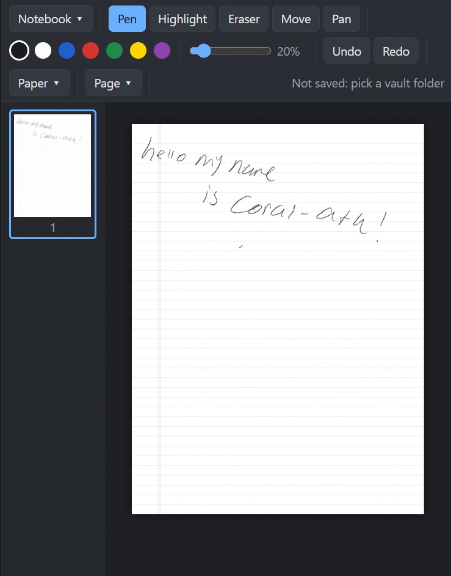
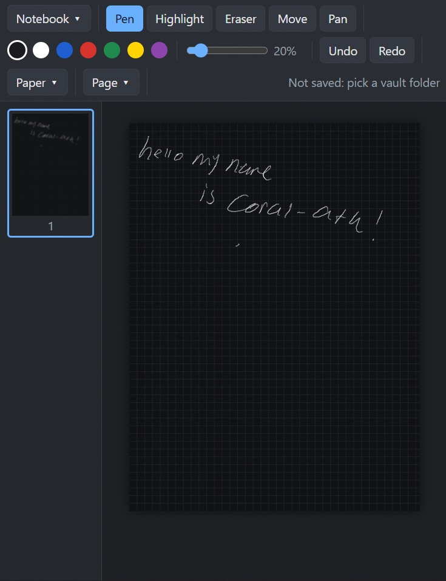
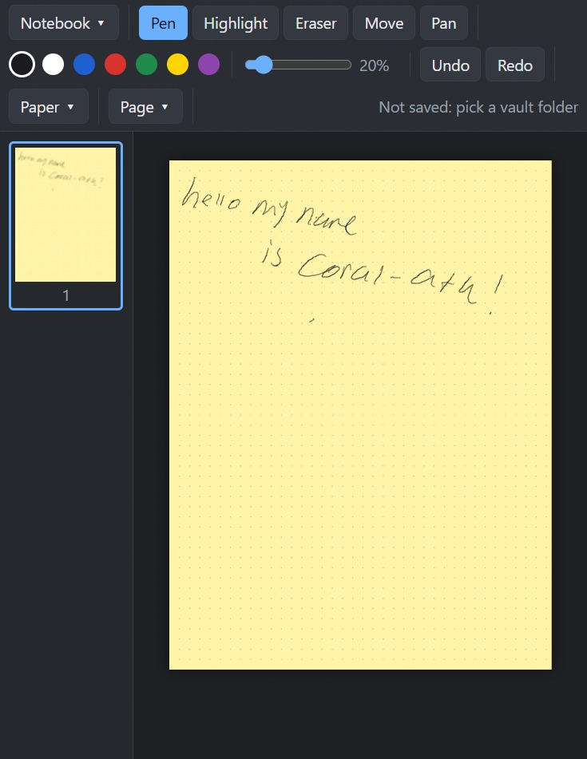

# NolePad

A tiny handwriting notebook for Windows. Draw with a pen tablet, insert PDFs and images, and save everything into a folder you already use, like an Obsidian vault.

It is one HTML file (about 22 KB). There is nothing to install and no account to make.

## Screenshots

| White, ruled lines | Black, grid | Yellow, dots |
| --- | --- | --- |
|  |  |  |

## Why

OneNote does a lot more than I need. I wanted something that does three things: draw, insert PDF, insert image. And I wanted my notes in plain files that Obsidian can read.

## Features

- Infinite canvas: pan and zoom out as far as you like, and write anywhere
- Pressure-sensitive pen, highlighter, and stroke eraser
- Insert PDFs (each page becomes a page you can write on), images, or paste from the clipboard
- Move and resize inserted images
- Paper: white, black, or yellow, with blank, grid, ruled lines, or dots
- Saves into a folder (your Obsidian vault) and autosaves as you work
- Hold a key to switch tools temporarily (works with pen buttons mapped to keys)
- Fixed pen thickness steps from 10% to 100%
- Undo and redo
- Works offline, except the first PDF import (see Notes)

## Requirements

- Windows with Microsoft Edge or Google Chrome (Edge is already on Windows)
- A pen tablet is optional. A mouse works too.

## Run it

1. Download `NolePad.html` and `NolePad.bat` and put them in the same folder.
2. Double-click `NolePad.bat`. It opens NolePad in its own window with no tabs or address bar.
3. Optional: right-click `NolePad.bat`, send it to the desktop as a shortcut, and pin it to the taskbar.

You can also just open `NolePad.html` in Edge or Chrome.

## Saving and Obsidian

1. Open **Notebook ▾**, then click **Choose vault folder** and pick your Obsidian vault (or any folder inside it).
2. Click **New notebook** and name it.
3. NolePad autosaves. For a notebook called `Physics` it writes:

```
YourVault/
├── Physics.md              <- embeds every page as an image
└── _ink/
    ├── Physics.ink.json    <- editable data (NolePad opens this)
    ├── Physics-p1.png      <- page images
    └── Physics-p2.png
```

Edit in NolePad, read and link in Obsidian. To edit a notebook again, choose it from the notebook list in NolePad. Page images are saved at 2x resolution so they stay sharp in Obsidian.

On the next launch NolePad remembers your folder. Edge sometimes asks you to click **Reconnect** first.

## Pen tablet (VEIKK and others)

- Pen pressure comes through Windows. In your tablet driver, turn on **Windows Ink**. Without it, drawing works but there is no pressure.
- After the first pen stroke, finger and palm touches are ignored.
- The eraser end of the pen erases, if your driver supports it.
- Map a pen button to a key (for example `E`) in the tablet driver to use the hold-to-switch shortcuts below.

## Shortcuts

| Key | Action |
| --- | --- |
| `P` | Pen |
| `H` | Highlighter |
| `E` | Eraser |
| `V` | Move and resize images |
| `W` | Pan |
| `Space` + drag | Pan |
| Middle mouse + drag | Pan |
| `[` and `]` | Thinner and thicker pen |
| `Ctrl+Z` / `Ctrl+Y` | Undo / redo |
| `Ctrl+S` | Save now |
| `Ctrl+V` | Paste an image |
| `Ctrl` + wheel | Zoom |
| `Home` or `0` | Fit the view to your content |
| `Delete` | Delete the selected image |
| `Esc` | Close a menu |

**Hold to switch:** hold a tool key and the tool changes only while you hold it, then returns to the previous tool. A quick tap (under about 350 ms) switches the tool and keeps it.

## Toolbar

- **Notebook ▾**: vault folder, reconnect, notebook list, new notebook
- **Pen, Highlight, Eraser, Move, Pan**: tools
- Color swatches and the size slider
- **Undo, Redo**
- **Paper ▾**: paper color and pattern (applies to the whole notebook)
- **Page ▾**: add page, delete page, fit to content, insert PDF, insert image

On black paper, black ink is shown as white automatically, so you do not end up with invisible ink.

## Notes and limitations

- Needs Edge or Chrome, because it uses the browser's folder access feature.
- The first PDF import loads the PDF reader (pdf.js) from the internet. Everything else works offline.
- The eraser removes whole strokes, not parts of a stroke.
- Normal pages are infinite. Pages imported from a PDF keep the size of the PDF page.
- The saved page image for an infinite page is cropped to what you wrote or inserted.
- Imported PDF pages keep their own white page, and no paper pattern is drawn on them.
- Notebooks store images inside the `.ink.json` file, so image-heavy notebooks get large.

## Making a real .exe (optional)

NolePad is a plain web page, so it can be wrapped as a small desktop app with a tool like [Tauri](https://tauri.app). That is not needed to use it.

## Credits

- [pdf.js](https://mozilla.github.io/pdf.js/) by Mozilla, loaded from cdnjs for PDF import

## License

Choose one before publishing. [MIT](https://choosealicense.com/licenses/mit/) is a common choice for small tools like this.
